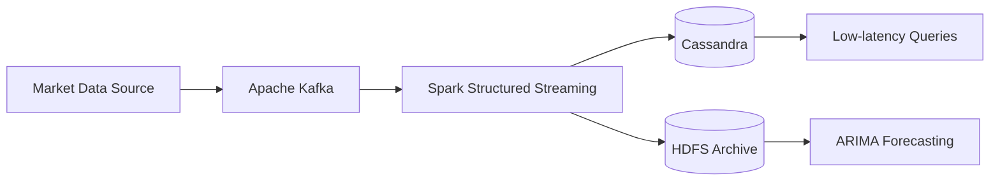

 

---

## 👨‍💻 About Me

I'm a **Master's student in AI & Data Science** (double degree between **FSDM Fès** and **Université Sorbonne Paris Nord**), passionate about **building scalable data systems** and **transforming raw data into valuable insights**.

I enjoy working across the whole data lifecycle: ingesting data in real time, modeling it properly, orchestrating reliable pipelines, and turning it into forecasts and ML-driven decisions.

> 🎯 **Goal:** Become a skilled Data Engineer by building real-world projects and developing reliable, scalable data architectures.

---

## 🚀 Current Focus

| | |
|---|---|
| 🔄 **Data Pipelines** | Building end-to-end ETL/ELT pipelines |
| ⚡ **Streaming** | Real-time processing and distributed systems |
| 🏛️ **Warehousing** | Data warehousing and dimensional data modeling |
| 🔁 **CDC** | Change Data Capture with Debezium and Kafka |
| ☁️ **Big Data** | Big Data and cloud technologies |

---

## 🛠️ Tech Stack

**Languages**

**Data Engineering**

**Big Data & Streaming**

**Databases**

**Data Analysis & Machine Learning**

**DevOps & Tools**

---

## 📂 Featured Projects

### ⚡ MASI Real-Time Market Data Pipeline
`Spark` `Kafka` `Cassandra` `HDFS` `Python` `Scala`

An end-to-end ingestion pipeline built on **Kafka** and **Spark Structured Streaming**, feeding **Cassandra** for low-latency market queries on the MASI index. Historical tick data is archived in **HDFS** and used for parallelised **ARIMA** forecasting.

### ⚽ Expected Goals (xG) Football Prediction Model
`Python` `Scikit-learn` `StatsBomb`

An ML pipeline that estimates shot quality (**xG**) from StatsBomb event data using location, body part, and play-pattern features. It matched the official StatsBomb benchmark across three classifiers.

### 🧠 Federated Learning for Depression Detection *(In Progress)*
`Python` `PyTorch` `Federated Learning`

A privacy-preserving federated/split learning pipeline that predicts depression indicators from head images. CNN models are trained across distributed clients with federated averaging, so no patient data is ever centralised.

### 📈 ML-Driven Portfolio Optimisation *(In Progress)*
`Python` `LightGBM` `LSTM` `cvxpy` `yfinance`

A LightGBM and LSTM ensemble for financial time-series forecasting, with walk-forward backtesting and mean-variance optimisation via **cvxpy** to build risk-adjusted portfolios.

---

## 🎓 Education & Experience

| | |
|---|---|
| 🎓 **Université Sorbonne Paris Nord** | Double-Degree Master's in Data Science *(In progress)* |
| 🎓 **FSDM Fès** | Master's in Data Engineering & Data Science *(Sep 2025 - In progress)* |
| 🎓 **FSDM Fès** | Licence in Mathematics & Computer Science *(2022 - 2025)* |
| 💼 **AGH Data Agency Holding SA** | Data Analyst Intern *(Jul 2026 - Aug 2026)* |

---

## 🌍 Languages

🇲🇦 **Arabic** (Native) &nbsp;•&nbsp; 🇫🇷 **French** (Fluent, C1) &nbsp;•&nbsp; 🇬🇧 **English** (Fluent, C1)

---

## 📊 GitHub Stats

---

## 📫 Connect with Me

*Open to internships, collaborations, and conversations about data engineering.*

