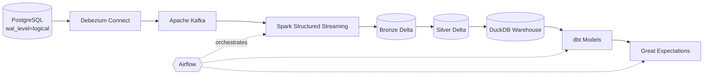
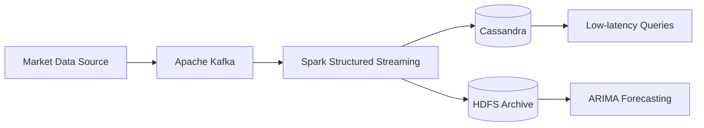

 

---

## 👨‍💻 About Me

I'm a **Master's student in AI & Data Science** (double degree between **FSDM Fès** and **Université Sorbonne Paris Nord**), passionate about **building scalable data systems** and **transforming raw data into valuable insights**.

I enjoy working across the whole data lifecycle: ingesting data in real time, modeling it properly, orchestrating reliable pipelines, and turning it into forecasts and ML-driven decisions.

> 🎯 **Goal:** Become a skilled Data Engineer by building real-world projects and developing reliable, scalable data architectures.

| 🔄 Data Pipelines | ⚡ Streaming | 🏛️ Warehousing | 🔁 CDC | ☁️ Big Data |
|:---:|:---:|:---:|:---:|:---:|
| ETL / ELT end to end | Real-time & distributed | Dimensional modeling | Debezium + Kafka | Cloud & lakehouse |

---

## 🛠️ Tech Stack

**Languages**

**Data Engineering & Streaming**

**ML & Analysis**

**DevOps & Tools**

---

## 📊 GitHub Activity

### 🔥 Contributions this year

> The **Total Commits** card shows commits for the current year, and the streak card shows total contributions with the current and longest streak.

### 🐍 Contribution snake

<picture>
  <source media="(prefers-color-scheme: dark)" srcset="https://raw.githubusercontent.com/justMouad/justMouad/output/github-snake-dark.svg" />
  <source media="(prefers-color-scheme: light)" srcset="https://raw.githubusercontent.com/justMouad/justMouad/output/github-snake.svg" />
  
</picture>

---

## 📂 Featured Projects

### 🔁 Real-Time CDC Lakehouse
`Debezium` `Kafka` `Spark` `Delta Lake` `SeaweedFS (S3)` `DuckDB` `dbt` `Great Expectations` `Airflow` `Docker`

A change-data-capture pipeline that streams every insert, update and delete from **PostgreSQL** through **Debezium** and **Kafka (KRaft)** into a **Delta Lake** on S3 with **Spark Structured Streaming** (Bronze → Silver). Data is then loaded into **DuckDB**, modeled with **dbt**, validated with **Great Expectations**, and orchestrated with **Airflow**. Handles live schema evolution and exactly-once recovery after a `kill -9`.

---

### ⚡ MASI Real-Time Market Data Pipeline
`Spark` `Kafka` `Cassandra` `HDFS` `Python` `Scala`

An end-to-end ingestion pipeline built on **Kafka** and **Spark Structured Streaming**, feeding **Cassandra** for low-latency market queries on the MASI index. Historical tick data is archived in **HDFS** and used for parallelised **ARIMA** forecasting.

### ⚽ Expected Goals (xG) Football Prediction Model
`Python` `Scikit-learn` `StatsBomb`

An ML pipeline that estimates shot quality (**xG**) from StatsBomb event data using location, body part, and play-pattern features. It matched the official StatsBomb benchmark across three classifiers.

### 🧠 Federated Learning for Depression Detection *(In Progress)*
`Python` `PyTorch` `Federated Learning`

A privacy-preserving federated/split learning pipeline that predicts depression indicators from head images. CNN models are trained across distributed clients with federated averaging, so no patient data is ever centralised.

### 📈 ML-Driven Portfolio Optimisation *(In Progress)*
`Python` `LightGBM` `LSTM` `cvxpy` `yfinance`

A LightGBM and LSTM ensemble for financial time-series forecasting, with walk-forward backtesting and mean-variance optimisation via **cvxpy** to build risk-adjusted portfolios.

---

## 🎓 Education & Experience

| | |
|---|---|
| 🎓 **Université Sorbonne Paris Nord** | Double-Degree Master's in Data Science *(In progress)* |
| 🎓 **FSDM Fès** | Master's in Data Engineering & Data Science *(Sep 2025 – In progress)* |
| 🎓 **FSDM Fès** | Licence in Mathematics & Computer Science *(2022 – 2025)* |
| 💼 **AGH Data Agency Holding SA** | Data Analyst Intern *(Jul 2026 – Aug 2026)* |

---

## 🌍 Languages

🇲🇦 **Arabic** (Native) &nbsp;•&nbsp; 🇫🇷 **French** (Fluent, C1) &nbsp;•&nbsp; 🇬🇧 **English** (Fluent, C1)

---

## 📫 Connect with Me

*Open to internships, collaborations, and conversations about data engineering.*

