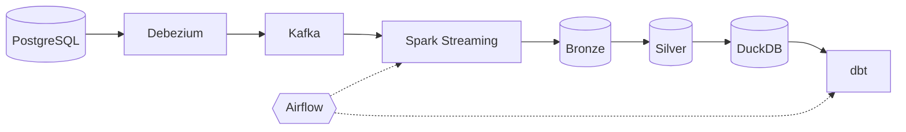
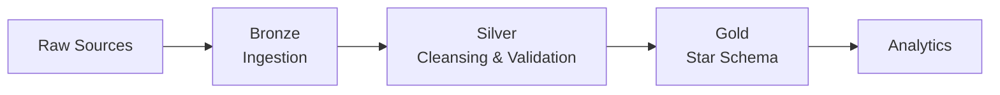

 

## 👨‍💻 About Me

Master's student in **Data Engineering & Data Science** at **FSDM Fès**, on a **double degree with Université Sorbonne Paris Nord**. I build **scalable data systems** and turn raw data into insights, with hands-on experience on banking data and in data analysis.

> 🎯 **Goal:** become a skilled Data Engineer by shipping real-world, reliable and scalable data architectures.

| 🔄 Pipelines | ⚡ Streaming | 🏛️ Modeling | 🔁 CDC | 🏅 Quality |
|:---:|:---:|:---:|:---:|:---:|
| ETL / ELT end to end | Kafka & Spark | Star schema | Debezium | Tests between layers |

## 🛠️ Tech Stack

**Languages**

**Data Engineering & Streaming**

**ML & Analysis**

**DevOps & Tools**

## 🐍 Contribution Snake

<picture>
  <source media="(prefers-color-scheme: dark)" srcset="https://raw.githubusercontent.com/justMouad/justMouad/output/github-snake-dark.svg" />
  <source media="(prefers-color-scheme: light)" srcset="https://raw.githubusercontent.com/justMouad/justMouad/output/github-snake.svg" />
  
</picture>

 

## 📂 Featured Projects

### 🔁 Real-Time CDC Streaming Lakehouse Platform
`Debezium` `Kafka` `Spark Structured Streaming` `Delta Lake` `DuckDB` `dbt` `Airflow` `Docker` `Python`

Captures every row-level change from **PostgreSQL** with **Debezium**, streams it through **Kafka** into a **Delta Lake** lakehouse with **Spark Structured Streaming** (Bronze → Silver), then models it with **dbt** in **DuckDB**, orchestrated by **Airflow**. Analytical tables stay continuously and incrementally up to date with low latency.

### 🏅 Data Platform with Medallion Architecture
`Python` `Spark` `Airflow` `dbt` `Docker`

End-to-end platform in **Bronze / Silver / Gold** layers: raw ingestion, cleansing and validation, then business-ready **star-schema** models. Orchestrated with **Airflow**, transformed with **dbt**, with data quality tests between layers.

### 🏗️ End-to-End Data Engineering Platform
`Python` `Kafka` `Airflow` `PostgreSQL` `Docker` `GitHub Actions`

Complete stack for ingestion, orchestration, transformation and serving of analytical data. Fully containerised with **Docker**, with **CI/CD via GitHub Actions** for automated testing and delivery.

<b>➕ More projects</b>

 

**⚡ MASI Real-Time Market Data Pipeline** · `Spark` `Kafka` `Cassandra` `HDFS` `Python` `Scala`
Kafka and Spark Structured Streaming feeding Cassandra for low-latency queries on the MASI index, with HDFS archiving and parallelised ARIMA forecasting.

**⚽ Expected Goals (xG) Prediction Model** · `Python` `Scikit-learn` `StatsBomb`
Estimates shot quality from StatsBomb event data and matched the official benchmark across three classifiers.

**🧠 Federated Learning for Depression Detection** *(in progress)* · `Python` `PyTorch`
Privacy-preserving federated learning with CNNs, so no patient data is centralised.

**📈 ML-Driven Portfolio Optimisation** *(in progress)* · `Python` `LightGBM` `LSTM` `cvxpy`
Ensemble forecasting with walk-forward backtesting and mean-variance optimisation.

## 💼 Experience & 🎓 Education

| | | |
|:--|:--|:--|
| 💼 **AGH Data Agency Holding SA** | Data Analyst Intern | Summer 2026 |
| 💼 **CIH Bank** | Data Engineering Intern | Summer 2025 |
| 🎓 **Université Sorbonne Paris Nord** | Double-Degree Master's in Data Science | In progress |
| 🎓 **FSDM Fès** | Master's in Data Engineering & Data Science | Sep 2025 – present |
| 🎓 **FSDM Fès** | Licence in Mathematics & Computer Science | 2022 – 2025 |

**🤝 Leadership:** President of the Chess Club (FPT) · Teaching Member of the English and French Club (USMBA)

**🌍 Languages:** 🇲🇦 Arabic (Native) · 🇫🇷 French (C1) · 🇬🇧 English (C1)

 

*Open to internships, collaborations and conversations about data engineering.*

